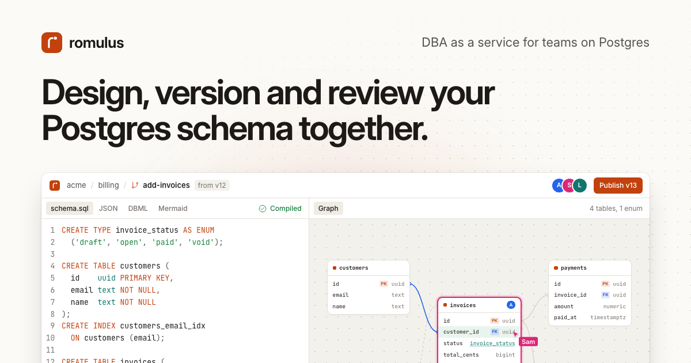

# romulus

**Design, version and review your Postgres schema together.**

romulus keeps every version of your schema, compares any two, lets your
team design the next one together, and writes its migration for the tool
you already run. It is DBA as a service for teams on Postgres.

romulus never connects to your database. Your schema reaches it as SQL, as
migration files, or pushed from CI, and every change compiles in a
sandboxed Postgres of the version you run (15, 16, 17 or 18).



## What it does

- **Versions.** Every upload, CI push, imported migration and published
  draft becomes a version that can't be edited afterwards. Each records who
  made it and where it came from.
- **Diffs.** Pick any two versions to see what changed: as a list, on the
  table graph and in SQL. Diffs are of the schema itself, so reformatting
  shows nothing and a column becoming `NOT NULL` does.
- **Drafts, together.** A draft is a branch of the schema the whole team
  edits at once: SQL on one side, the table graph on the other, everyone's
  cursor in both. Each change compiles in a real Postgres, and errors point
  at the line. Rename, add or drop tables and columns or draw a foreign key
  on the graph, and romulus writes the SQL. Write the schema, or write the
  migration by hand. When a new version lands first, **Update draft** merges
  it statement by statement.
- **Review.** Comment on a table, a column, a statement or any spot on the
  graph, mention teammates, resolve threads. Require approvals before
  publishing. The discussion stays with the version.
- **Migrations.** Files for plain SQL, sqlx, Flyway, Prisma, dbmate or
  golang-migrate, with a down migration where the tool has one. Each
  statement is marked when it deletes data, can fail on existing rows, or
  widens access through row-level security.
- **Migration import.** Bring the history you have: folders of sqlx,
  dbmate, golang-migrate, node-pg-migrate, Flyway or Prisma migrations
  (Rails, Django and Alembic through the SQL they print) become one version
  per migration.
- **Pushes from CI.** [remus](https://github.com/lupidae/remus) reads your
  database's schema in CI and pushes it with a token scoped to one
  database. An unchanged schema creates nothing.
- **Playgrounds.** A real Postgres holding a version's schema and generated
  rows. Query it, run a draft's migration on it to see each statement's
  locks, rewrites and timing, then reset. Each one runs isolated in gVisor.
- **Your AI agent.** Claude Code, Claude Desktop, Cursor or any MCP client
  works in romulus as you, with a personal access token: it reads schemas,
  drafts a change, tests its migration on data and asks for a review, under
  your organization's rules. [docs/mcp.md](docs/mcp.md) connects it.
- **Migration tests in CI.** `romulus test`, a small command line (and a
  GitHub Action), runs a pull request's new migrations on a playground of
  the database's latest version with generated rows, and fails the job when
  one fails, locks a table dangerously or loses data.
  [docs/cli.md](docs/cli.md) sets it up.

## Quick start

### Use the hosted service

[romulus.lupidae.com](https://romulus.lupidae.com/) runs it for you: a free
plan for one person, and [flat plans for teams](https://romulus.lupidae.com/#pricing)
with unlimited members.

### Run it on your own server

One Linux host (x86-64 or arm64) with Docker and 4 GB of memory:

```bash
git clone https://github.com/lupidae/romulus.git
cd romulus/deploy/self-host
./install.sh
```

The installer checks the host, asks a few questions (the URL, the first
admin, mail, playgrounds), starts everything and prints a link to set the
admin's password. Self-hosting is the whole product, free, with one
organization per install. Read [docs/self-host/install.md](docs/self-host/install.md)
first; upgrades, backups and hardening are next to it in
[docs/self-host](docs/self-host).

### Run it on Kubernetes

```bash
helm install romulus oci://ghcr.io/lupidae/charts/romulus \
  -n romulus --create-namespace --set host=romulus.example.com
```

The same images and settings as the installer's, playgrounds aside.
[docs/self-host/kubernetes.md](docs/self-host/kubernetes.md) is the guide:
TLS, an external Postgres, upgrades, backups.

### Work on romulus

[CONTRIBUTING.md](CONTRIBUTING.md) explains how to set up a development
stack (Rust, Docker, Node and `just`; then `just dev`). [CLAUDE.md](CLAUDE.md)
maps the repository and its conventions, and [docs/MVP.md](docs/MVP.md) is
the product's specification.

## The repository

| path | what |
|---|---|
| `crates/romulus-api` | the API (Rust, axum): auth, organizations, versions, drafts and their live collaboration, comments, imports, playgrounds |
| `crates/romulus-sandbox` | SQL to schema model, compiled in a sandboxed Postgres |
| `crates/romulus-diff`, `crates/romulus-migration` | model diffs, and migrations planned from them |
| `crates/romulus-playground`, `crates/romulus-play-runner` | the playground service and the only process that talks to Docker |
| `crates/romulus-wasm` | the homepage's in-browser engine |
| `crates/romulus-cli`, `action.yml` | `romulus test`, the command line that tests migrations from CI, and its GitHub Action |
| `web/` | the web app (React, Vite, TanStack, CodeMirror, React Flow, Yjs) |
| `deploy/self-host` | the self-hosted bundle: `compose.yaml` and `install.sh` |
| `deploy/sandbox`, `deploy/playground` | the Postgres images SQL compiles in and playgrounds run |
| `migrations/` | the app database's migrations |
| `docs/` | the specification, design notes, self-hosting guides |

## remus, the twin

[remus](https://github.com/lupidae/remus) is romulus's command-line twin
(Apache-2.0): it reads a Postgres database's schema into a model, diffs
two of them, and pushes schemas to romulus from CI. The schema model lives
in remus (`remus-core` on crates.io), and romulus builds on it.

## License

romulus is licensed under the GNU Affero General Public License, version 3
only ([LICENSE](LICENSE), [NOTICE](NOTICE)). If you run a modified romulus
as a network service, you must offer its source to its users. Code in
[`ee/`](ee/) will be under a separate commercial license. remus is
Apache-2.0.

## Security

Please report vulnerabilities privately, as [SECURITY.md](SECURITY.md)
explains, never in a public issue.

## Contributing

Contributions are welcome: see [CONTRIBUTING.md](CONTRIBUTING.md). Your
first pull request asks you to sign the contributor license agreement
([CLA.md](CLA.md)), which lets the maintainers named in [NOTICE](NOTICE)
relicense contributions (the commercial `ee/` license among them). Everyone taking part follows the
[code of conduct](CODE_OF_CONDUCT.md).
